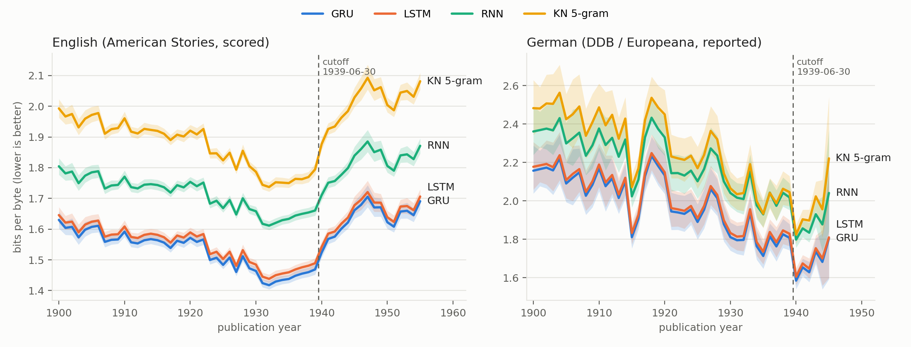

# Baselines v1 — per-year bits-per-byte of the four non-Transformer models

Generated 2026-10-22 from `reports/<run>/bpb_by_year.json` and `runs/<run>/log.jsonl`
(figure: `python scripts/make_baselines_figure.py`).

| | |
|---|---|
| Training stream | `data/shards/main`, MANIFEST sha256 `e2030e139f2a…` (corpus v1, frozen 2026-10-20) |
| Val slices | MANIFEST sha256 `dacc175fd7b2…`: English American Stories val, 8M tokens; German DDB + Europeana val, 4M tokens |
| Per-year sets | held-out split, embargo excluded, ~1M tokens per year per language: English 222,843 documents (51.9M tokens, 1900–1955, set `522290378170`); German 7,328 documents (41.0M tokens, 1900–1945, set `b26dc60ba722`) |
| Scoring | every document scored on its own from `<|endoftext|>`, windows of 4,096 with stride 2,048; bpb = summed NLL (bits) / UTF-8 bytes of the document targets; 95 % CI = bootstrap over documents (1,000 resamples, seed 20261019) |
| Code | `7317db7` (recurrent runs), `38214ae` (n-gram) |

## Models

| Run | Model | Parameters | Training | LR (200M-token probes, Val English bpb) | Wall time on the 5080 |
|---|---|---|---|---|---|
| `ngram_kn5` | KenLM modified Kneser-Ney 5-gram, no pruning, binary trie | 1.7B n-grams (15.7 GiB) | first 1B tokens of the main stream (998M tokens, 1,989,211 documents) | — | 32 min on CPU, with per-year scoring |
| `gru_50m` | GRU, 2 layers, h 832, tied embeddings | 49,211,136 | 12B tokens, 45,776 steps of 2^18 tokens | **2e-3** (2.171; 1e-3 2.291; 5e-4 2.401) | 10-20 07:47 → 10-21 08:30 (incl. a 1.9 h power loss and resume) |
| `lstm_50m` | LSTM, 2 layers, h 800, tied embeddings | 49,574,400 | same | **2e-3** (2.557; 5e-4 2.648; 1e-3 2.893) | 10-19 12:30 → 10-20 07:38 |
| `rnn_50m` | tanh RNN, 2 layers, h 960, tied embeddings | 50,876,160 | same | **2.5e-4** (2.449; 1.25e-4 2.619; 5e-4 2.454; 1e-3 2.859; 2e-3 2.878) | 10-21 08:39 → 10-22 03:50 |

All recurrent runs: AdamW (0.9, 0.95), weight decay 0.1, 1,000 warmup steps, cosine to 10 %, clip 1.0, bf16,
rows of 4,096 tokens with the state reset per row, ~187k tokens/s. The RNN grid was extended downwards
because the lowest probed rate was the best (decision 2026-10-19).

## Results

Val bpb at the end of training (point estimates on the fixed Val slices; the per-year table below carries CIs):

| Model | Val English | Val German |
|---|---|---|
| GRU | **1.5257** | **2.0041** |
| LSTM | 1.5446 | 2.0206 |
| RNN | 1.7107 | 2.2129 |
| KN 5-gram | not computed (user, 2026-10-21) | not computed |

Per-year English bpb (95 % CI) at selected years; every year is in `reports/<run>/bpb_by_year.csv`:

| Year | GRU | LSTM | RNN | KN 5-gram |
|---|---|---|---|---|
| 1900 | 1.630 | 1.646 | 1.804 | 1.993 (1.963–2.023) |
| 1920 | 1.572 | 1.589 | 1.754 | 1.920 |
| 1932 (lowest, all four) | **1.418** | 1.438 | 1.611 | 1.737 |
| 1935 | 1.438 | 1.459 | 1.633 | 1.750 |
| 1939 | 1.469 | 1.489 | 1.661 | 1.794 |
| 1940 | 1.524 | 1.542 | 1.710 | 1.877 |
| 1947 (highest after the cutoff) | 1.706 | 1.721 | 1.885 | 2.092 |
| 1955 | 1.691 | 1.706 | 1.871 | 2.081 |

| Mean English bpb | GRU | LSTM | RNN | KN 5-gram |
|---|---|---|---|---|
| 1900–1909 | 1.592 | 1.609 | 1.769 | 1.954 |
| 1930–1938 | 1.441 | 1.462 | 1.635 | 1.757 |
| 1940–1955 | 1.635 | 1.651 | 1.817 | 2.011 |
| after − before (1940–55 minus 1930–38) | +0.194 | +0.189 | +0.181 | +0.253 |

## Reading

- **Ranking:** GRU < LSTM < RNN < KN 5-gram in all 56 English years and in 45 of 46 German years (1936:
  RNN and 5-gram tie, 2.043 vs 2.042). GRU is 0.02 bpb below LSTM in every year, but their per-year CIs
  overlap in every year (a paired bootstrap would be needed to call it). The RNN is ~0.19 behind the GRU,
  the 5-gram another 0.12–0.19 behind the RNN. The ungated RNN needed an 8x smaller learning rate.
- **The boundary is visible in all four models.** English bpb falls from the 1900s to a minimum in 1932,
  stays low through 1939 (the most recent, most repeated training years), and rises steeply after the
  cutoff to a peak in 1947: +0.18 to +0.25 bpb for the post-1939 mean over the 1930s mean. Text from 1945–1955
  is harder for every model than text from 1900. The 5-gram, which only stores n-gram counts of the
  first 1B tokens, has the largest jump.
- **Baselines alone do not separate knowledge from style.** A rise after 1939 also follows from drift in
  vocabulary, typography and OCR quality; the OCR-quality covariate regression (Phase 5) and the main
  Transformer's curve against these four are what the RQs use.
- **German (reported, not a criterion):** the curve is noisier (110–206 documents per year up to 1939) and
  *drops* after 1939 (GRU 1.80 in 1930–38, 1.62 in 1940–42). The German post-1939 set is small
  (1943: 106 documents, 1944: 29, 1945: 3, with wide CIs) and comes from a different mix of titles; it is
  not interpreted until the per-year source and OCR mix is tabulated.
- **Samples** (greedy + 3 at T = 0.8, top-k 40, 60 tokens, four "Hitler" prompts) are in `reports/samples/`.
  None of the three recurrent models produces a coherent answer; GRU and LSTM keep the topic (German
  government, Nazi regime) for a sentence or two, the RNN drifts to American Legion and church notices.

## Gate (TASKS Phase 3)

Four baselines evaluated (per-year bpb with bootstrap CIs, both languages; Val bpb for the three neural
models) and both resume tests passed (`runs/resume_test_lstm_50m`, `runs/resume_test_s335m`): Phase 4 may start.
